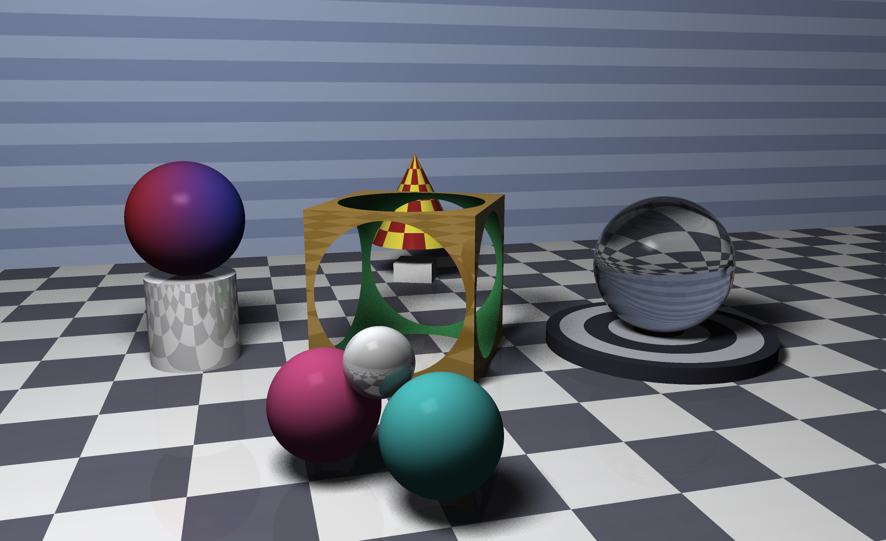
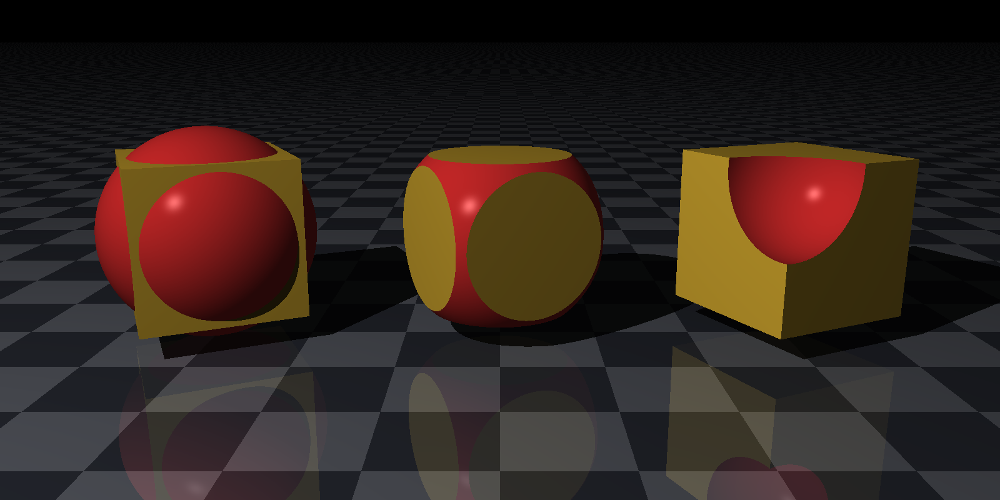
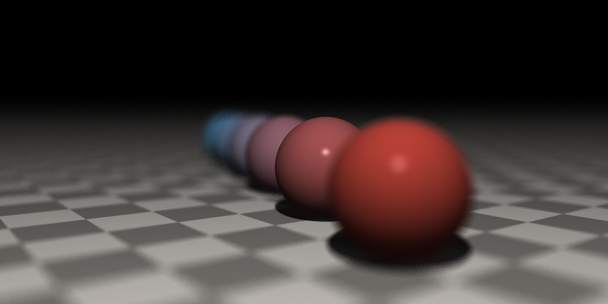
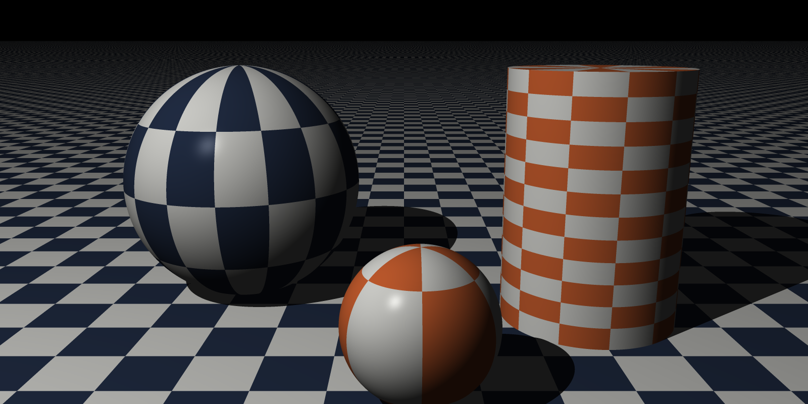
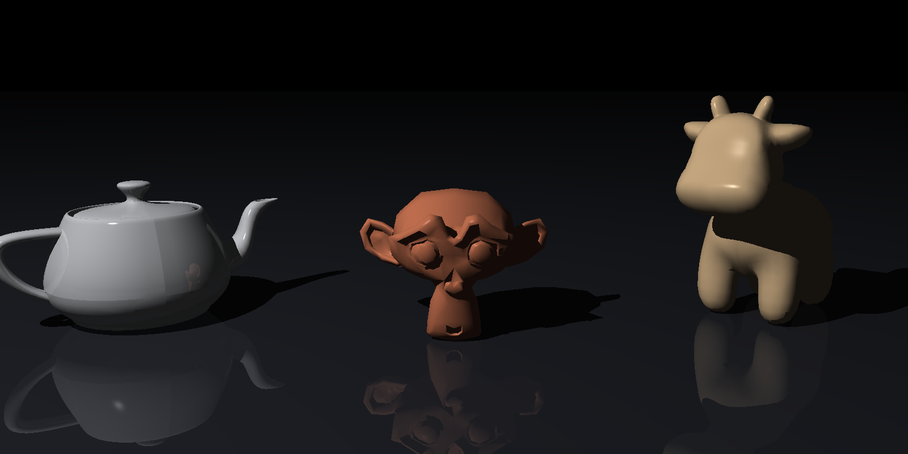

# The Ray Tracer Challenge in Zig

A ray tracer written from scratch in [Zig](https://ziglang.org) 0.16 while
working through _The Ray Tracer Challenge_ by Jamis Buck. The implementation
follows the book's test scenarios.



| | |
|:-:|:-:|
|  |  |
| Constructive solid geometry | Depth of field |
|  |  |
| UV texture maps | Smooth-shaded OBJ meshes |

Renders of every supported scene are in [`gallery/`](gallery/).

## Features

- Spheres, planes, cubes, cylinders and cones (truncated, open or capped),
  and triangles with flat or interpolated normals.
- Groups with bounding-box culling and CSG union, intersection and difference.
- A Wavefront OBJ reader. The Utah teapot, Suzanne and Spot the cow are
  included in [`models/`](models/).
- Phong lighting, shadows, recursive reflection and refraction with Fresnel
  (Schlick) blending. Shadow casting can be disabled for individual shapes.
- Stripes, gradients, rings, 3D checkers and UV checkers with planar,
  spherical or cylindrical mapping.
- Point lights, area lights for soft shadows, supersampling and a thin-lens
  camera for focal blur.
- A YAML-subset scene format with reusable definitions that can be extended.
- Parallel row rendering. Tuples, colors and matrices use SIMD `@Vector`s,
  are generic over the float type and work at `comptime`.
- PNG output, written atomically to disk or streamed to stdout.

## Building

The project requires Zig 0.16.0. The repository pins the compiler and linters
in a [devenv](https://devenv.sh) shell, which direnv activates on entry.

```sh
zig build                # build
zig build test           # run the test suite
devenv test              # full gate: fmt, actionlint, zizmor, build, tests
```

Use `-Doptimize=ReleaseFast` for rendering; the default debug build is much slower.

## Usage

```
gallery [SCENE | FILE.yml | all] [SIZE | WIDTH HEIGHT | WIDTHxHEIGHT] [-o DIR]
```

```sh
# The newest scene at the default 400x200
zig build run -Doptimize=ReleaseFast

# One named scene, larger (`--help` lists them all)
zig build run -Doptimize=ReleaseFast -- soft-shadows 1200x600

# Every scene, grouped into subdirectories, as in gallery/
zig build run -Doptimize=ReleaseFast -- all 1600x800 -o gallery

# A scene file, at the size it asks for unless one is given
zig build run -Doptimize=ReleaseFast -- scenes/cover.yml -o out
```

Without `-o`, images are saved in `ray-tracer-gallery` under the system
temporary directory. When stdout is redirected, a single scene's image is
written there instead. This lets you pipe it to a viewer:

```sh
zig build run -Doptimize=ReleaseFast -- scenes/showcase.yml | feh -
```

## Scene files

Scene files in [`scenes/`](scenes/) contain a list of `add` and `define`
entries. Use `add` to place a camera, light or shape, and `define` to name
a material or transform for later entries to use or `extend`.

```yaml
- add: camera
  width: 800
  height: 600
  field-of-view: 0.7854
  from: [-3, 2.5, -6]
  to: [0, 0.6, 0]
  up: [0, 1, 0]
  supersample: 2

- add: light
  at: [-6, 8, -8]
  intensity: [1, 1, 1]

- define: glass
  value:
    color: [0.05, 0.08, 0.08]
    reflective: 0.9
    transparency: 0.9
    refractive-index: 1.52

- add: sphere
  material: glass
  shadow: false
  transform:
    - [scale, 1.2, 1.2, 1.2]
    - [translate, -1.6, 1.2, 0.4]
```

Supported shapes are `sphere`, `plane`, `cube`, `cylinder`, `cone`, `group`
(with `children`) and `csg` (with `operation`, `left`, `right`). Lights use
`light` or `area-light`. The reader rejects unknown keys.
[`scenes/showcase.yml`](scenes/showcase.yml) uses all supported scene-file
features.

## Layout

| Path | Contents |
|---|---|
| `src/math/` | tuples, matrices, transformations, noise |
| `src/scene/` | rays, shapes, intersections, materials, patterns, lights, the world, OBJ and scene-file readers |
| `src/render/` | colors, canvas, camera, PNG output |
| `src/demo/` | the built-in scenes |
| `src/main.zig` | the command-line renderer |
| `scenes/` | example scene files |
| `models/` | OBJ meshes |
| `gallery/` | rendered images of every scene |
